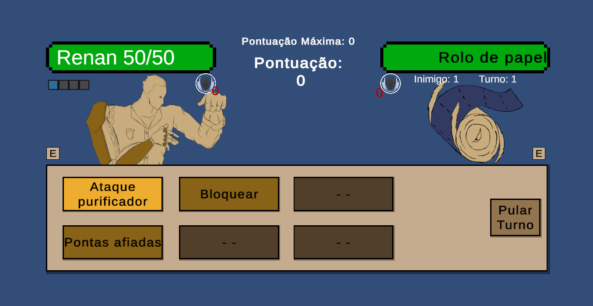

# Ilhas do Conhecimento

Ilhas do Conhecimento é um jogo RPG com combate por turnos, com o objetivo de conscientizar sobre a reciclagem e descarte indevido de lixo.

O projeto está sendo desenvolvido individualmente apenas com ajuda para documentação acadêmica, completamente livre de IA tanto no desenvolvimento quanto no design e desenho de personagens e inimigos.

Projeto foi feito para práticar:
- Programação em C# e boas práticas em programação
- Utilização de métodos e ferramentas da plataforma unity
- Balanceamento

O projeto ainda está em desenvolvimento como TCC para graduação em Engenharia da Computação.

Para facilitar acesso ao jogo segue o link para download da build jogável do projeto:
https://drive.google.com/drive/folders/1fq1ma2hPmr9Pz5JrWIT_CWRut1O6lZNr
